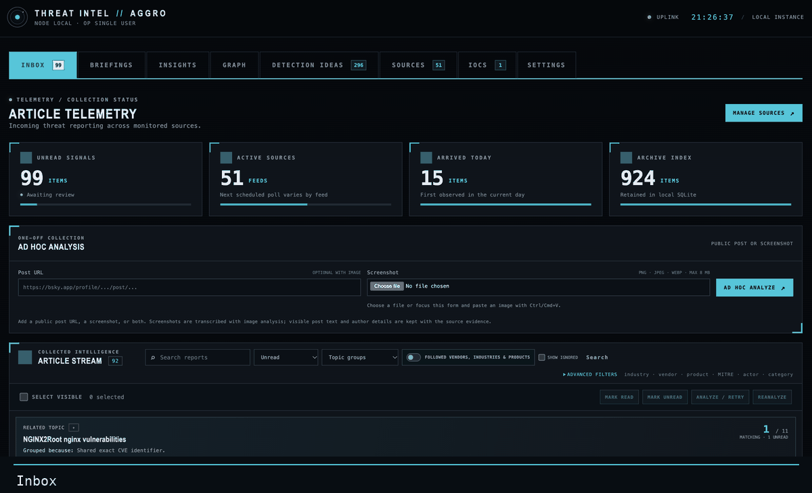

# Threat Intel Aggro

A self-hosted threat intelligence reader and detection workbench. Collect public reports, research their context, review indicators, and turn supported findings into detection drafts.

Built with ASP.NET Core Razor Pages and SQLite. Runs in a Docker container with persistent local storage.

## Features

- RSS/Atom feeds, GitHub security advisories, OPML import, and scheduled collection.
- One-off article URLs and screenshot analysis.
- AI research and enrichment with source excerpts and evidence links.
- Inbox search, article grouping, and filters for followed vendors, industries, and products.
- IOC review, classification, approval, exclusions, expiry, CSV export, and a bearer-key API.
- Defender XDR and Sentinel detection drafts with KQL validation and JSON, KQL, and XDRConverter YAML downloads.
- Daily briefings with Markdown and PDF downloads, plus a private RSS feed.
- Graph and insights views, automatic backups, and optional feed fetching through a Tailscale exit node.

## Authentication warning

> [!WARNING]
> **Threat Intel Aggro has no built-in user authentication.** Anyone who can reach the application can access its web UI and administrative actions. You are responsible for controlling access to your deployment. The IOC API key and secret RSS URL protect only their respective endpoints.

## AI data processing

All data submitted for analysis is processed by AI and sent to OpenAI. This includes feed and article content, URLs, uploaded screenshots, extracted text, and briefing inputs. Check that you may share this data under its Traffic Light Protocol (TLP) designation, applicable privacy law, and your organization's rules. Review AI-generated findings and detection drafts before using them.

## Documentation

- [Setup and configuration](docs/SETUP.md)
- [Using the application and IOC API](docs/USAGE.md)
- [Backups and restore](docs/BACKUPS.md)
- [Data contracts](docs/DATA_CONTRACTS.md)
- [Releasing](docs/RELEASING.md)

Licensed under the [MIT License](LICENSE).
