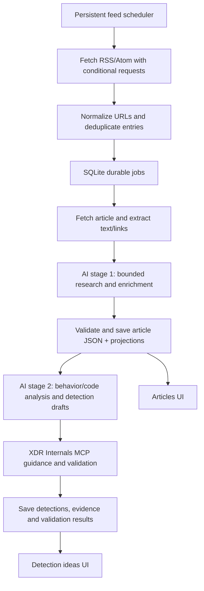

# Threat Intel Aggro — implementation plan

Planning baseline: 2026-11-13. This document describes the intended implementation; it does not claim that the application or external integrations have been tested.

## 1. Agreed scope

- One owner; private application with access controlled by the owner's Entra-enabled reverse proxy. The application does not implement human sign-in or user allowlisting.
- Approximately 100 RSS/Atom feeds; refresh every few hours or daily.
- Add, edit, pause, remove, and manually refresh feeds. Accept feed URLs later.
- On addition, ingest entries from the preceding 14 days, as available in that feed.
- Research each article and related public blogs/code; save a structured, evidence-linked intelligence object.
- Generate detection ideas whenever supported by sufficient evidence, with or without linked code.
- Target Microsoft Defender XDR and Sentinel's unified schema; use XDR Internals MCP for guidance and validation.
- Present sortable/filterable article and detection lists. Explicit read/unread controls; detection workflow includes implemented and reversible archive.
- Retain intelligence, detections, and evidence indefinitely, with explicit manual deletion.
- No automatic reanalysis of completed articles; retry interrupted or failed work only.
- Self-host on the owner's existing server using Docker. No Cloudflare, Python, Node.js, or npm.
- The owner manages AI project spending limits externally. Record usage and handle quota failures, without adding an application monetary budget gate.

## 2. Architecture and dependency policy

Use C# on .NET 11 and ASP.NET Core Razor Pages. Server-rendered HTML, handwritten CSS, and small vanilla JavaScript modules provide filters, bulk actions, dialogs, clipboard copying, and status refreshes. Use system fonts and local assets; no CDN assets or JavaScript packages.

Run one ASP.NET Core process in one container. Kestrel serves the UI; hosted `BackgroundService` implementations run the scheduler and durable job consumer. AI requests never run in page request handlers. The database owns job state; in-memory wake-up signals are an optimization only.

SQLite stores the application data on a persistent local filesystem volume. Use WAL, foreign keys, a busy timeout, short transactions, and one job consumer initially. Perform no network request inside a database transaction. One application replica is supported. Do not put the database on an NFS/SMB mount.

Use parameterized SQL through a small .NET P/Invoke adapter to the system SQLite library and numbered SQL migrations. This avoids adding a package restore just for SQLite while keeping the database server-free. Full-text search uses SQLite FTS5, whose availability is verified during startup. JSON remains available for export; relational projections support indexed filters and relationships. A graph database, vector database, ORM, Redis, and external job broker are unnecessary for this workload.

Proposed direct runtime NuGet dependencies, subject to the first implementation spike:

| Package | Purpose |
| --- | --- |
| Native system SQLite via P/Invoke | SQLite driver without a NuGet dependency; Docker runtime installs `libsqlite3-0` |
| No extra RSS or frontend packages initially | RSS/Atom XML uses the hardened built-in XML reader; HTML extraction can add AngleSharp when AI enrichment is implemented |
| PdfPig | Text extraction from text-based PDF documents |
| ModelContextProtocol.Core | Official MCP client with minimum SDK surface |
| JsonSchema.Net | Local validation of the versioned AI JSON contracts |
| YamlDotNet | Safe YAML serialization for XDRConverter exports |

Use platform `HttpClient`, `System.Text.Json`, cookie authentication, password hashing, antiforgery, rate limiting, logging, and hosted services. Send OpenAI-compatible requests directly through small typed HTTP adapters, avoiding an agent orchestration framework or a second SDK dependency. Extract article text using semantic elements and tested heuristics; introduce a specialist extractor only if representative sources justify it.

Pin direct and transitive NuGet versions with a committed lockfile, restore in locked mode in CI, and use a supported pinned .NET SDK/base-image family. Test-only packages may be added where needed. Minimize dependencies without hand-writing HTML, PDF, feed, MCP, or JSON Schema parsers.

## 3. End-to-end processing



### Feed acquisition

- Default refresh interval: six hours; per-feed choices of 3, 6, 12, or 24 hours. Store due times in UTC, spread polling with jitter, and avoid simultaneous requests to one host.
- Run the scheduler every minute and enqueue only due feeds, with a unique active-job key. Persist next poll time, ETag, Last-Modified, last success, and error details.
- Initial fetch accepts only entries dated within 14 days. Feeds rarely expose complete history; show the accessible date range and never claim the full two weeks were recovered. Undated entries are held as date-unknown and require an explicit include action during initial backfill.
- Later polls accept newly observed undated entries with their first-seen timestamp. Exclude clearly future-dated entries until due; preserve original dates for diagnosis.
- Deduplicate by normalized canonical URL across feeds and by feed-scoped GUID. Normalize tracking parameters conservatively; retain meaningful URL query parameters. Keep a feed/article join table so one article can belong to multiple feeds.
- Retrieve the original article even when the RSS body is only a teaser. Store the RSS fallback and extraction completeness if the original is inaccessible.
- Removing a feed leaves previously collected articles intact. Pausing does not delete anything. Keep redirect and canonical URL evidence, and only accept canonical hints that pass URL validation.

### AI stage 1: intelligence research

1. Supply the article text, metadata, extracted links, and existing evidence identifiers.
2. Enable bounded public web research for related reporting and public code. Search the article's concrete entities, techniques, CVEs, malware names, and linked projects.
3. Retrieve selected sources through the application's fetch tools, so evidence can be recorded and consistently constrained.
4. Return the article contract in `DATA_CONTRACTS.md` using strict structured output where supported. Validate schema, references, formats, allowed enums, IOC types, and ATT&CK IDs locally before publishing results.
5. Save JSON and relational projections in one transaction. Unsupported mappings remain empty; uncertain attribution is explicitly labeled as inferred.

The owner selects the model and reasoning effort in Settings, with an application default and optional independent overrides per AI step. Model names and effort values are not fixed in analysis request code. Existing installations retain their effective configuration on migration; new installations require an explicit, validated selection before AI processing starts. Never silently replace an unavailable model. Settings reports missing credentials/capabilities; ingestion and browsing still work without an AI key. See the AI configuration plan below.

### AI stage 2: detection generation

1. Run for every enriched article; code is useful evidence, not a prerequisite.
2. Resolve tracked public code links to immutable commit/file versions when the host permits. Analyze behavior and observable side effects, not merely README claims. Cite file paths and line ranges for code-derived findings.
3. Use article evidence when no code is present. Return a reasoned `no_supported_detection` outcome where evidence or available telemetry is insufficient. Never force a speculative query.
4. Produce up to three distinct draft ideas per article initially. Each includes KQL, alert title/description, severity, techniques, telemetry requirements, false positives, tuning, and a written investigation/response playbook.
5. Consult the MCP's schema, examples, and validation capabilities. Use unified XDR/Sentinel context where exposed; identify target tables and connector requirements per detection.
6. Independently submit every saved query to the MCP validator. Store its actual response, environment/profile/version when provided, query hash, and validation time. Do not trust a model's claim that validation succeeded.
7. Allow one bounded repair attempt with validator diagnostics. Persist an invalid or unvalidated draft with prominent status rather than calling it validated. Validation outage retries resume this step without rerunning completed enrichment.

Distinguish schema/syntax validation, custom-detection result shape checks, and tenant testing. A schema-valid query is not proof of useful detection, available data, low false positives, or successful execution. No tenant connection is required in version one; tenant testing starts as `not_tested` and can be manually documented.

## 4. Research limits and retrieval policy

These are workload bounds, not monetary budget gates. Defaults are configurable and recorded per run:

| Resource | Initial bound per article |
| --- | --- |
| Public search | Up to 3 search tool invocations |
| Related reporting | Up to 5 fetched pages, at most 2 link levels |
| Code | Up to 2 repositories and 20 relevant text files total |
| Code text supplied | Up to 100,000 characters total |
| Article/related text supplied | Up to 100,000 characters total |
| Retrieval | 20 MB per document, 30 extracted PDF pages, 5 redirects |
| HTML/feed/code request timeout | 30 seconds, with bounded streaming downloads |
| PDF retrieval/extraction | 90 seconds total, cancellable and memory-bounded |
| AI output | Initial maximum of 16,000 output tokens per generation request, including reasoning where charged against the cap |
| Agent/tool loop | At most 12 external tool executions per stage; 15-minute stage deadline |
| Generation repair | One invalid JSON or KQL repair per stage within the stage limits |
| Active article AI pipelines | One initially |

The output-token cap may be insufficient for some max-effort tasks. An incomplete response is a visible failure, not valid JSON; do not automatically keep increasing the limit. Tune defaults with evaluation fixtures and actual usage.

Track all discovered code links. Process the most relevant within the bounds and store deferred/skipped links with reasons. Do not clone an entire repository or recursively crawl the public web. A shared evidence cache reuses already fetched identical sources; each analysis records the exact content hash it used.

PDF handling initially covers text-based PDFs. Scanned documents, encrypted PDFs, paywalls, and JavaScript-only sites get explicit unsupported/incomplete status. Preserve useful RSS/extracted content. OCR and a headless browser are later optional additions, not silent deployment requirements. Non-English text can be processed by the model; summaries and UI default to English.

Domain preferences are a small settings table, neutral by default. Later weights affect source selection priority; they never establish truth or suppress conflicting evidence. Avoid a mandatory approved-domain list.

## 5. Providers and MCP integration

Define a small `IAiProvider` contract for structured generation, tool continuations, capability discovery/probes, normalized errors, and usage reporting. OpenAI Responses API is the primary implementation. A logical analysis stage can involve multiple HTTP requests as tools run; there is no promise of exactly two billable requests per article.

Azure support is a separate adapter using the same contracts and `HttpClient`: endpoint, deployment name, API mode/version when required, key secret, and supported effort settings. Do not assume the OpenAI model name equals an Azure deployment name. Capability checks must cover structured output, function tools, reasoning effort, web search, and MCP behavior for the selected deployment.

Keep web research behind an `IResearchProvider` interface. OpenAI-hosted web search is the default. If an Azure deployment lacks equivalent search, allow separately configured OpenAI research with explicit configuration; otherwise mark Azure enrichment setup incomplete. Never silently omit the required related-source research or send content to an unconfigured provider.

Connect to `https://mcp.xdrinternals.com` with the official C# MCP client, without authentication. Discover transport and tools; do not assume undocumented paths, method names, argument shapes, or environment IDs. The endpoint could not be reached during this planning session, so the first implementation spike must verify handshake, list-tools, unified schema lookup, and a harmless validation fixture.

Only expose discovered read-only schema/help/validation tools through an allowlist. Application-side MCP calls provide both deterministic validation and tool results to the model. If the MCP is unavailable, save drafts as `unavailable`, show diagnostics, and retry validation later. A missing or unusable validator never produces a green validation badge.

## 6. Persistence and job lifecycle

| Table/group | Purpose |
| --- | --- |
| owner_accounts | Single login, password hash, lockout metadata |
| feeds | URL, name, enabled, interval, poll metadata, backfill date |
| articles / article_feeds | Canonical article metadata, read state, feed membership |
| sources / article_sources | Retrieved source metadata, role, URL, hash, extraction state, snapshot path |
| analyses | Validated JSON, schema/prompt/model versions, completion status |
| entities / aliases / article_entity_links | Actors, malware, campaigns, industries, countries, vendors, products, vulnerabilities; relationship role and evidence |
| attack_techniques / article_techniques | Versioned ATT&CK taxonomy, tactic/technique mappings and evidence |
| indicators / article_indicators | Normalized IOC types/values, source attribution and maliciousness context |
| detections / detection_sources | Article link, JSON, KQL, review status, archive timestamp, supporting sources |
| detection_validations | Validator result and diagnostics tied to the exact KQL hash |
| jobs | Stage, state, due time, attempts, lease, idempotency key, safe error details |
| ai_runs / tool_runs | Provider/model/effort, request IDs, status, token/tool usage, timing, errors |
| domain_preferences / settings | Source weighting and non-secret application preferences |
| deletion_tombstones | Minimal URL/GUID hashes to prevent deleted articles from immediately reappearing |
| schema_migrations | Applied numbered SQL migration versions |

Use stable IDs and UTC timestamps. Index article date/read state, feed due times, normalized entity names, IOC values, detection workflow/archive/validation state, and runnable jobs. Use FTS5 for article title/summary, entity names, detection description, and KQL; join selected filters with pagination. Preserve source-name aliases without automatically treating similarly named actors as the same group.

Job states: `queued`, `running`, `retry_wait`, `blocked_configuration`, `blocked_quota`, `succeeded`, `failed`, `cancelled`. Claim jobs with a short atomic transaction and renewable lease. Recover expired leases on restart. Unique stage/article keys prevent duplicate persisted results. A crash after a provider accepted a request can still cause duplicate billing; save provider response IDs promptly and resume/poll where supported rather than promising exactly-once external calls.

Retry transient network/server errors up to three total attempts with exponential backoff/jitter and `Retry-After`. Rate-limit errors use bounded waiting. Quota and authentication failures block AI jobs until configuration is fixed and the owner resumes them. Continue polling feeds and serving stored results. Permanent bad-source errors remain visible and do not loop indefinitely.

Completed analyses are immutable machine outputs. Store manual JSON/KQL corrections separately as the effective version with a small revision history. Editing KQL invalidates the prior validation badge and queues validation of the new hash; it does not reanalyze the article. A changed source article does not trigger another AI run.

## 7. Owner experience

Use a compact dark interface with accessible contrast, keyboard focus, responsive layouts, and dense desktop tables. Keep article intelligence and detection review separate but cross-linked.

| View | Main behavior |
| --- | --- |
| Articles | Default unread/newest; sortable date, feed, title, processing state; filters for read state, date, feed, actor, industry, affected vendor/product, MITRE, malware, CVE, country, IOC type, detection availability |
| Article detail | Linked original title, summary, confidence/evidence badges, IOC table, mappings (including affected products with vendor/version/impact role), related references, code coverage/skips, linked detections, raw/effective JSON |
| Detection ideas | Sort/filter by created date, severity, workflow, validation, source, technique, required table, and archived state; text search and linked article |
| Detection detail | KQL in a readable monospace block with copy/download; downloadable XDRConverter-compatible `.yaml` and JSON; alert metadata, rationale, code/behavior evidence, telemetry gaps, diagnostics, false positives, tuning, playbook, notes and revisions |
| Feeds | Add/edit/remove/pause/refresh; interval, last success, accessible backfill range, backlog and errors |
| Settings/status | Provider/model/effort, credential-presence indicator, MCP health, research limits, domain preferences, job queue, usage and backup status; briefing follows support affected vendors, targeted industries, and affected products |

Read state is explicit: opening an article never marks it read. Include bulk mark read/unread with a clear selection count. Single-owner states need no multi-user schema now.

### AI model and reasoning effort settings (implemented 2026-11-15)

Add an **AI configuration** panel to the existing Settings page. The owner can change the model and effort without editing source, environment variables, or Compose files, and without restarting the application.

- Show a default model selector and a reasoning-effort selector. Include a provider-default effort choice that omits the explicit effort parameter when appropriate. Explain that effort can affect latency and token use.
- Populate OpenAI model choices from the account's `/v1/models` list with a refresh action and keep an explicit ID entry for Azure deployments or other models the list cannot enumerate. A successful model listing alone does not establish compatibility with this application's requests.
- Offer the common `none`, `low`, `medium`, and `high` effort values. Provider-specific compatibility is confirmed by the actual structured request; surface a rejection on the affected article and never silently substitute a model or effort. Avoid a billable probe during Settings load or save.
- Keep the common case to one default pair. Under advanced settings, allow separate overrides for **Research**, **Article analysis**, **Detection generation**, and **KQL repair**. Each override can inherit the default pair. These correspond to the current `research`, `article-analysis`, `detection-generation`, and `kql-repair-*` calls in `AnalysisService`.
- Show the effective model/effort for each step, credential-presence status, compatibility status, and field-specific validation errors. Saving is a local operation; any check that sends a billable generation request must be an explicit action labeled accordingly. Invalid input leaves the last saved configuration intact and preserves the submitted form values for correction.

Implementation sequence:

1. **Central settings service and persistence.** Introduce a typed AI settings service backed by the existing SQLite `app_settings` table, with an atomic save and a configuration revision. Keep provider credentials in the existing secret configuration. On first upgrade only, import effective `OpenAI:Model`, `OpenAI:ReasoningEffort`, `OpenAI:ResearchEffort`, `OpenAI:AnalysisEffort`, and `OpenAI:RepairEffort` values, including the current code fallbacks when absent. Map `AnalysisEffort` to both article analysis and detection generation. Persist the imported values so subsequent Settings changes take precedence over deployment configuration. Fresh installations remain unconfigured until a model/effort selection is saved.
2. **Settings form and validation.** Extend `Pages/Settings.cshtml` and its page model with the selectors, optional step overrides, refresh/check actions, and antiforgery-protected save handler. Reuse the existing responsive form styling. Validate model identifiers, effort values, and known capability constraints on the server as well as in the UI. Model discovery failures must leave saved choices visible and unchanged.
3. **Analysis integration.** Replace direct model/effort reads and inline fallback strings in `AnalysisService` with the settings service. Snapshot the effective configuration and revision when a new article analysis begins, persist that snapshot, and use it for every step, repair, and retry of that analysis. Saving settings affects analyses that have not begun; it does not switch an active analysis midway, resubmit an accepted background response, invalidate completed stage results, or reanalyze completed articles. For an analysis already in progress during upgrade, preserve known request metadata and seed missing snapshot values from the imported legacy configuration without resubmitting existing responses.
4. **Run provenance and errors.** Persist the requested provider/model/effort and configuration revision with each AI request, plus the actual returned model when available. Capability or provider rejection must produce an actionable configuration error with a link to Settings; never fall back to a different selection. Preserve existing resumable response IDs and cached stage results.
5. **Documentation and focused verification.** Document Settings as the normal configuration path and environment variables as migration/bootstrap input only. Add fixture-based tests for persistence across restart, configuration precedence, legacy import, all four step overrides, invalid values, request serialization including omitted provider-default effort, and an in-progress analysis retaining its snapshot after a settings change. Verify the Settings save/reload flow and responsive layout locally without paid API calls.

Acceptance: select a different compatible model and effort in Settings, save, reload, and restart the app; the next new analysis uses the saved selection in every applicable request and records it in run metadata. Advanced overrides apply only to their designated steps. Existing analyses retain their saved configuration, and an unavailable selection produces a visible error instead of a silent replacement. The analysis request builder contains no fixed model name or effort fallback.

Detection review status: `new`, `reviewing`, `accepted`, `rejected`, `implemented`. Archive is an independent timestamp, so implemented/rejected status survives archive/restore. The owner can change status without a rigid sequence. Implemented is a manual assertion, not proof of deployment or a tenant API call. Optional implementation URL/date and tenant-test notes may be recorded.

Allow notes, tags, bookmarks, and deliberate correction of JSON/KQL. Form edits must pass the same local contract checks as AI output. Export effective article/detection JSON, current filtered lists as CSV, and individual queries as `.kql` and XDRConverter-compatible `.yaml`; protect CSV text cells from formula execution. Include prominent clickable provenance links. YAML is generated from the effective saved detection on demand so edits cannot leave a stale sidecar file.

The XDRConverter YAML is an export format, distinct from the richer internal detection contract. Its schema requires fields such as `guid`, `ruleName`, `frequency`, `alertTitle`, `alertSeverity`, `alertDescription`, `tactics`, and `queryText`. Keep the full MITRE mapping, evidence, limitations, review workflow, and playbook in the internal JSON export because the converter schema cannot represent every field. XDR custom detection YAML supports one tactic per rule; select the primary tactic for YAML and warn when additional mapped tactics remain in the internal detection record. Preserve all associated techniques/sub-techniques supported by that tactic. Put the playbook summary in `alertRecommendedAction` when it fits; retain the complete playbook in JSON.

Export each rule with a persisted stable GUID, a bounded rule name, XDR-compatible severity, and the KQL query. Use the suggested detection frequency if it matches converter-supported values (`1H`, `3H`, `12H`, `24H`); otherwise use `24H` and show that default in the export preview. Export with `status: disabled` unless the owner explicitly selects enabled in the export dialog. YAML export only creates a file; it does not call PowerShell, XDRConverter, Microsoft Graph, or deploy a rule. Keep the generator separate from app runtime by default, and validate exported fixtures against the pinned upstream `CustomDetection.schema.json` and `ConvertTo-CustomDetectionJson` in optional PowerShell-based integration checks.

Deletion is explicit and confirmed with the affected scope. Article deletion removes its generated intelligence, linked detection ideas, and unshared snapshots. Deleting a detection removes that idea and its validation/revisions; it is not regenerated automatically. Preserve minimal article tombstones unless the owner explicitly chooses full removal and possible rediscovery. Deletion of local data does not retroactively erase existing backups or provider-side records.

## 8. Docker operation, access, and retention

- Multi-stage Dockerfile: supported .NET SDK build image to ASP.NET runtime image; run as a non-root user with a writable `/data` volume and read-only application files.
- One Compose service, one persistent volume, `restart: unless-stopped`, HTTP health check, graceful cancellation/shutdown, and documented UID/file permissions. No companion database, scheduler, or queue container.
- Initial sizing target: 1 vCPU and 1–2 GB RAM, to be measured using realistic backfill/PDF fixtures. Bound document sizes and retain the single AI worker to avoid memory spikes.
- Prefer an existing reverse proxy for TLS. Default published port binds to loopback; document explicit LAN/VPN exposure. No automatic public publishing.
- Process forwarded client IP and scheme headers only from explicitly configured proxy IPs, with a one-hop limit. In Docker, document the proxy address visible to the app container (often the bridge gateway when NGINX runs on the host); do not trust arbitrary forwarded headers or broad networks.
- Human sign-in and user allowlisting are handled by the hosting environment or reverse proxy. That layer must protect every UI route, including Settings. The application does not consume Entra tokens or require an Entra client secret. Keep antiforgery protection for Razor form posts and persist Data Protection keys under `/data`.
- Require a generated high-entropy bearer key for every `/api/*` route. Generate and rotate it in Settings, store only its SHA-256 hash, show each new key once, and accept the prior key for up to 24 hours after rotation. Keep `/health` unauthenticated for container health checks; never accept API keys in query strings.
- Provide `.env.example` with placeholders. Credentials come from environment variables or mounted secret files, never stored in the Git repo, article records, exports, or logs. Provider keys are entered operationally, not revealed in settings.
- Data layout: `/data/aggro.db`, `/data/evidence/`, `/data/keys/`, `/data/backups/`. Evidence uses hashes and explicit ownership links for safe garbage collection after manual deletion.
- No automatic age-based deletion of intelligence or retained evidence. Show disk usage and stop new retrieval cleanly if storage is exhausted.
- Default nightly online SQLite backup through the SQLite backup API, with an application-coordinated snapshot manifest for evidence and keys. Briefly gate writes/deletions while capturing a consistent manifest/snapshot. Never copy only the live main WAL database file.
- Keep seven daily and four weekly backup snapshots; this rotation affects backups, not live intelligence retention. Allow a different backup location and document server-level/off-host copies. Include a tested restore procedure.
- Logs are structured and size-rotated; distinguish operational log retention from permanent intelligence retention. Health checks cover DB access, scheduler/worker heartbeat, and disk; provider/MCP outages are shown separately rather than causing a container restart loop.

On an already running server, hosting adds no new platform subscription; actual incremental costs are server resources, storage/backups, and AI/search. Report observed tokens and search calls rather than inventing a cost before article volume is known. At three search calls per article, 100 articles/day would yield up to 9,000 calls/month: at the currently documented $10/1,000 calls, that is $90 for search calls alone before model/search-content tokens. This is an illustration, not a workload prediction. Start with one targeted related-source search and expand only where useful, up to the configured bound; reuse already inspected related sources and record research coverage. Feed count alone is insufficient to predict daily article volume.

## 9. Source-handling boundaries

Fetched pages, RSS, code, and MCP results are untrusted data. They cannot override system instructions, disclose secrets, change settings, deploy detections, or execute code. Render extracted text with HTML encoding; do not inject remote page HTML into the UI. Keep an appropriately restrictive Content Security Policy.

Use one shared safe retrieval service for feed URLs, article links, AI tool requests, redirects, PDFs, and code. Accept HTTP/HTTPS only, reject credentials and private/loopback/link-local/metadata targets, validate every redirect, resolve and pin allowed public addresses to prevent DNS rebinding, and bound streamed bytes/decompression/time. Explicitly configured provider/MCP endpoints use separate outbound clients. Disable XML external entities/DTDs. Fetch public code as data, never run it. An optional read-only public GitHub token can be configured for API limits; private repository access is out of scope.

## 10. Planned repository structure

```text
src/ThreatIntelAggro/
  Program.cs
  Pages/                      # Razor pages, login, forms and handlers
  wwwroot/css/ wwwroot/js/     # Handwritten local assets
  Domain/                     # Entities, typed contracts and enums
  Data/ Migrations/           # SQL access and numbered migrations
  Services/Feeds/ Retrieval/ Intelligence/ Detections/
  Providers/                  # OpenAI, Azure, search and MCP adapters
  Jobs/                       # Scheduler, leases, worker, retry policy
  Schemas/                    # Versioned JSON schemas
tests/ThreatIntelAggro.Tests/
  Fixtures/                   # Offline feeds, HTML/PDF/code and provider responses
docs/
Dockerfile
compose.yaml
.env.example
global.json
packages.lock.json            # In project directories as required by NuGet
```

## 10a. Local development and validation loop

Routine validation runs on the owner's machine and never deploys or publishes anything. Use `dotnet restore --locked-mode`, `dotnet build --no-restore`, `dotnet test --no-restore`, and `dotnet run --project src/ThreatIntelAggro`, then review the app at its configured `http://localhost:<port>` address in a browser. UI work can use `dotnet watch`. Also run `docker compose up --build` to check the production-like container locally before updating the server.

Include a local setup command that creates a separate development database and evidence directory, interactively sets the owner password, applies migrations, and optionally loads synthetic demo records using reserved example domains. Fixture mode supplies local feed, HTML/PDF, code, AI, and MCP responses; it has no external calls by default. Optional live integration checks can enable public feeds, OpenAI/Azure, or MCP individually using local secrets. Unit and browser checks do not need API keys or live services. Demonstrate isolated fixture data surviving restart and ensure reset commands show the resolved development data path before deletion.

Local checks should cover startup, health, login, article and detection views, read/edit/archive/restore flows, JSON/KQL/YAML exports, and a fixture job surviving a restart. Stop the local container with `docker compose down`; never run volume purge as routine cleanup. Do not push source, publish an image, SSH to the host, or deploy as part of validation. After a local build, fixture tests, browser review, and optional converter check pass, a separately documented server update can be performed.

## 11. Delivery milestones and acceptance checks

### A. Integration and dependency spike

Verify the installed .NET SDK, choose supported package versions, confirm RSS/Atom and PDF extraction fixtures, and connect to MCP: handshake, tool discovery, unified schema lookup, valid and invalid KQL fixtures. Map exact tool names/arguments into the adapter. Confirm OpenAI capability requirements from documentation/mocked responses; perform a live smoke test only after a key is supplied. Exercise Azure endpoint/deployment configuration with fixtures. The spike must settle actual MCP transport and tool compatibility before labeling validation functional.

### B. Runnable foundation

Create the Razor app, single-owner setup/login, SQLite migrations, Docker/Compose setup, durable jobs, and health/status views. Verify database and Data Protection persistence across restarts, unauthorized access rejection, antiforgery protection, and interrupted job recovery. No AI key is required for startup.

### C. Feed ingestion and article inbox

Implement feed CRUD, pause/refresh, six-hour default scheduling, two-week available backfill, conditional requests, deduplication, explicit read state, extraction and search/filter/pagination. Verify a synthetic 100-feed fixture set, duplicate links across feeds, date-unknown policy, feed failure isolation, and removal preserving articles.

### D. Structured intelligence

Implement the Settings-based AI configuration plan in section 7 before extending AI processing. Then implement evidence snapshots, bounded research tools, strict schemas, normalization/projections, article detail and JSON/CSV export. Test grounded IOC/context separation, unknown actors remaining unknown, industry/vendor roles, non-English text, truncated PDFs, unsupported content, refusal/incomplete JSON, retries, quota blocking, and prompt-injection fixtures. Verify configured search/file/tool limits cannot be bypassed by model instructions.

### E. Detection workbench

Implement code relevance selection, no-code behavior detection, evidence-linked KQL drafts, MCP validation/repair, detection views, all review states including implemented, archive/restore, edits, `.kql` export, and XDRConverter-compatible `.yaml` export. Verify unsupported evidence yields an explicit no-detection result; invalid/unavailable validation is never shown as passed; KQL edits invalidate prior validation; table/connector gaps and custom-rule result-shape diagnostics are visible; generated YAML converts against the pinned upstream schema and converter.

### F. Operational completion

Finish backup/restore, manual delete and tombstones, secret/log redaction, safe retrieval tests, disk/health reporting, locked dependency restore and container smoke tests. Measure resource use and initial backlog throughput. A small CI pipeline on GitHub can later run restore/build/tests/container checks; implementation initially stays local.

Use focused .NET unit/integration tests for contracts, ingestion, job recovery, retrieval restrictions, and persistence. Use ASP.NET integration tests for auth and mutations, plus a short manual localhost browser QA pass for list/detail/edit flows. Ordinary tests use fixtures and never spend AI credits or depend on live MCP. Live integration results are recorded separately. Validate the app in a local browser and local Docker image before any server update.

## 12. Deferred work and remaining inputs

Deferred: notifications, automatic reanalysis, automatic deployment or execution of detections, tenant API access, STIX/TAXII, private repositories, OCR, browser automation, multi-user collaboration, distributed workers, and a graph visualization/database.

Owner-provided inputs can arrive during implementation: feed URLs, OpenAI API key, optional Azure endpoint/deployment/key, representative articles/code, and server reverse-proxy details. Defaults are English output, one local owner, local filesystem persistence, and written playbook ideas. No additional product-design questionnaire is required before implementation.

## Sources checked while planning

- [.NET support policy](https://dotnet.microsoft.com/en-us/platform/support/policy/dotnet-core)
- [ASP.NET hosted background services](https://learn.microsoft.com/en-us/aspnet/core/fundamentals/host/hosted-services?view=aspnetcore-11.0)
- [Microsoft.Data.Sqlite](https://learn.microsoft.com/en-us/dotnet/standard/data/sqlite/)
- [SQLite deployment fit](https://www.sqlite.org/whentouse.html)
- [Official C# MCP SDK](https://github.com/modelcontextprotocol/csharp-sdk) and [HTTP transport](https://github.com/modelcontextprotocol/csharp-sdk/blob/main/docs/concepts/transports/transports.md)
- [OpenAI structured output](https://developers.openai.com/api/docs/guides/structured-outputs), [web search](https://developers.openai.com/api/docs/guides/tools-web-search), [Luna model](https://developers.openai.com/api/docs/models/gpt-6-luna), and [pricing](https://developers.openai.com/api/docs/pricing)
- [Azure Responses API](https://learn.microsoft.com/en-us/azure/foundry/openai/how-to/responses?view=foundry-classic)
- [Microsoft custom detection rules](https://learn.microsoft.com/en-us/defender-xdr/custom-detection-rules)
- [XDRConverter YAML schema, field mapping and conversion cmdlets](https://github.com/f-bader/XDRConverter)
