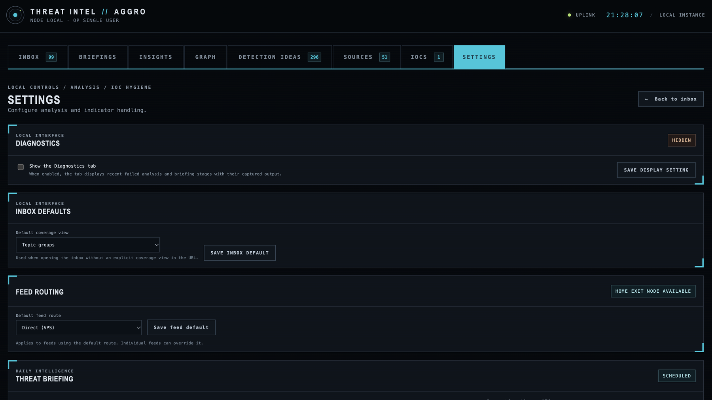

# Setup and configuration

## Docker Compose

Copy `.env.example` to `.env`, set `OPENAI_API_KEY`, and start the app from the repository root.

```sh
cp .env.example .env
docker compose up -d
```

Open [localhost:5088](http://localhost:5088), then select a model in **Settings → AI model and reasoning**. The app starts with the Unit 42 feed and collects available entries from the last 14 days.

Compose pulls `ghcr.io/f-bader/threatintelaggro` and stores the database, keys, and backups in the `aggro-data` volume at `/data`. The published port binds to host loopback. To update the image, run `docker compose pull` followed by `docker compose up -d`.

| Setting | Purpose |
| --- | --- |
| `OPENAI_API_KEY` | OpenAI credential |
| `AGGRO_IMAGE_TAG` | Container version, default `latest` |
| `AGGRO_TRUSTED_PROXY_IPS` | Comma-separated proxy IPs trusted for forwarded client IP and scheme, empty by default |
| `AGGRO_DATA_DIR` | Local storage directory, set to `/data` by Compose |

Compose reads the first three settings from `.env`. For a different data location, edit the service's volume mapping and `AGGRO_DATA_DIR` together.

The app trusts one forwarded-header hop from the listed proxy IPs. Use the proxy address as seen by the container. Restart the app after changing the list. API and RSS limits are 120 and 30 requests per minute per client IP respectively, with HTTP 429 and `Retry-After` when exceeded. Requests through a proxy share its budget unless trusted forwarding provides the client IP.

The [README authentication warning](../README.md#authentication-warning) applies to every deployment.

## Run from source

Install the .NET SDK version in `global.json`. From the repository root, run the following commands and set `OPENAI_API_KEY` in your environment.

```sh
DOTNET_CLI_HOME="$PWD/.dotnet-cli" dotnet restore src/ThreatIntelAggro/ThreatIntelAggro.csproj
AGGRO_DATA_DIR="$PWD/.local-data" DOTNET_CLI_HOME="$PWD/.dotnet-cli" dotnet run --project src/ThreatIntelAggro
```

To build the container from the checkout, use the development overlay.

```sh
docker compose -f compose.yaml -f compose.dev.yaml up --build
```



## AI settings

Choose the default model and reasoning effort in Settings. Refreshing the model list makes no generation request. Per-stage overrides cover research, article analysis, detection generation, and KQL repair. Each analysis keeps its settings across retries. Credentials come from deployment configuration.

The application uses OpenAI's Responses API. KQL assistance and validation use `https://mcp.xdrinternals.com` when available. Provider errors and validation results appear in the application.

For a source installation, `OpenAI__ApiKey` is also supported. `OpenAI__MaxOutputTokens` sets the output cap between 1,000 and 64,000 tokens. Add these explicitly to the service environment if using Compose.

## Optional Tailscale feed routing

Prepare an approved Tailscale exit node and make `/dev/net/tun` available on the Docker host. Add `AGGRO_TAILSCALE_EXIT_NODE` with the node's Tailscale IP and `AGGRO_TAILSCALE_AUTHKEY` with an enrollment key to `.env`.

```sh
docker compose -f compose.yaml -f compose.tailscale.yaml up -d
```

For a source build, insert `-f compose.dev.yaml` before the Tailscale overlay and add `--build`.

Select **Home exit node** under **Feeds → Edit**, or set the default in **Settings → Feed routing**. New and imported feeds inherit the default. The route covers feed and GitHub advisory collection. Article retrieval and AI requests use their own clients. An unavailable home route reports a failure without retrying directly.

The sidecar identity persists in `tailscale-feed-state`. The proxy has no published port and accepts CONNECT requests from the app bridge to vetted public destinations. If `172.30.181.0/24` conflicts with your network, change it in both `compose.tailscale.yaml` and `deploy/feed-proxy.conf`. Switch home-routed feeds back to Direct before removing the overlay.

## Volume permission errors

The container runs as UID 1654. For an older named volume that fails with access denied on `/data/keys`, repair ownership once.

```sh
docker compose run --rm --user 0:0 --entrypoint sh threat-intel-aggro -c 'chown -R "$APP_UID:$APP_UID" /data'
docker compose up -d
```

For bind mounts, make the host directory writable by UID 1654. See [backups and restore](BACKUPS.md) before moving stored data.
