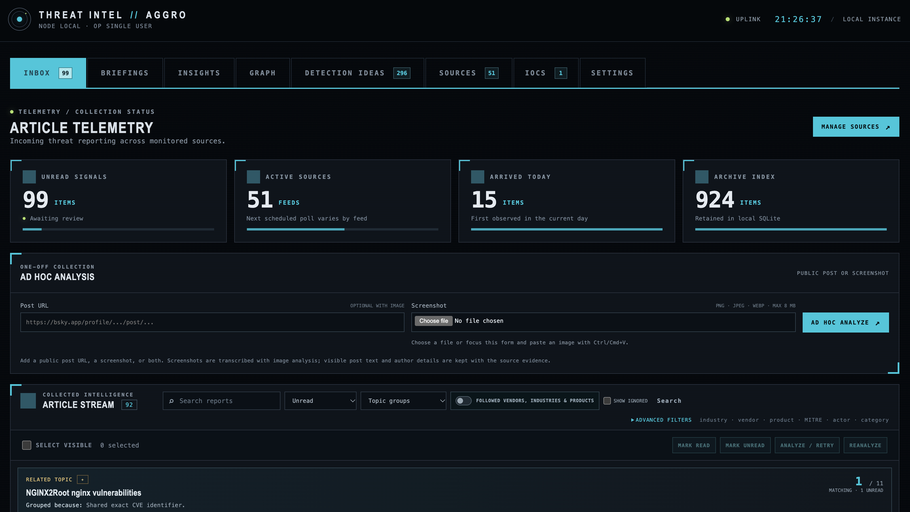
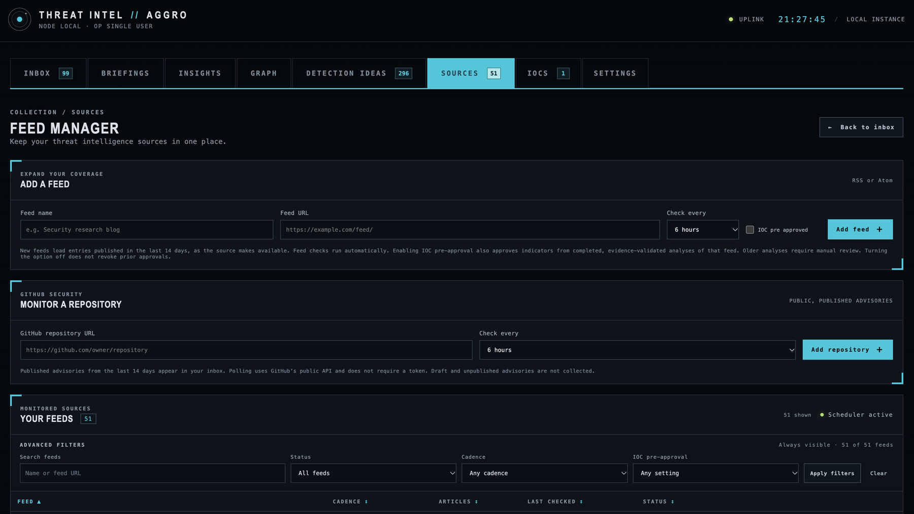
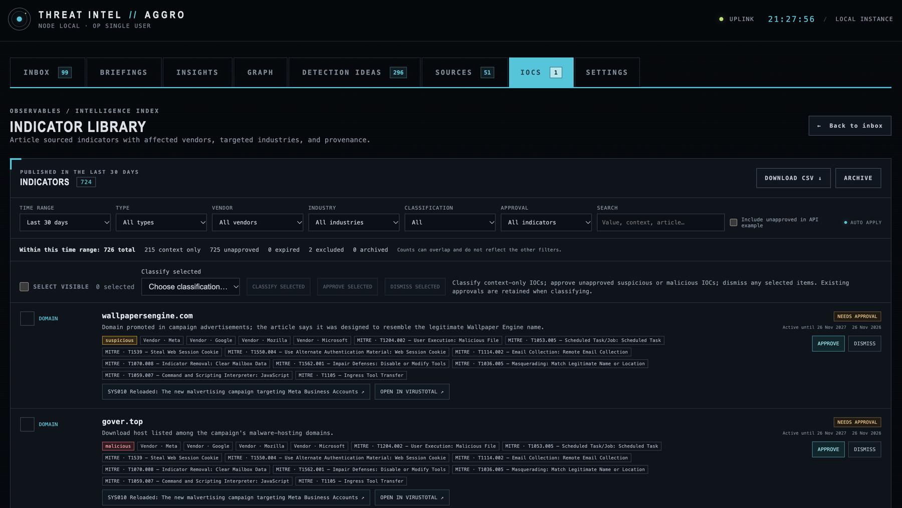
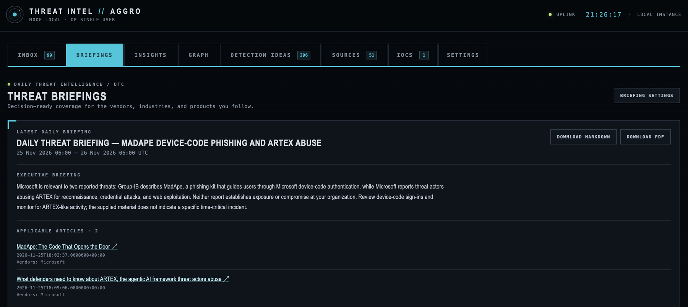
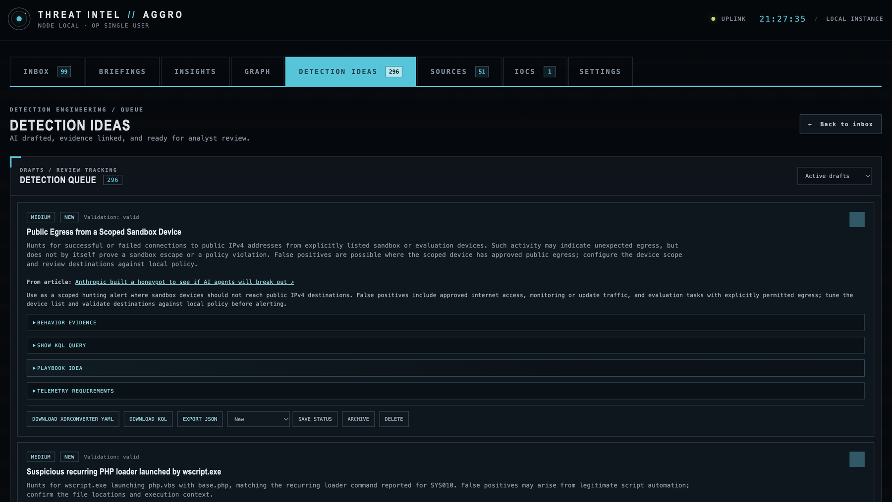
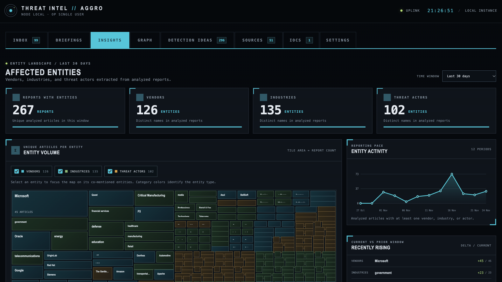
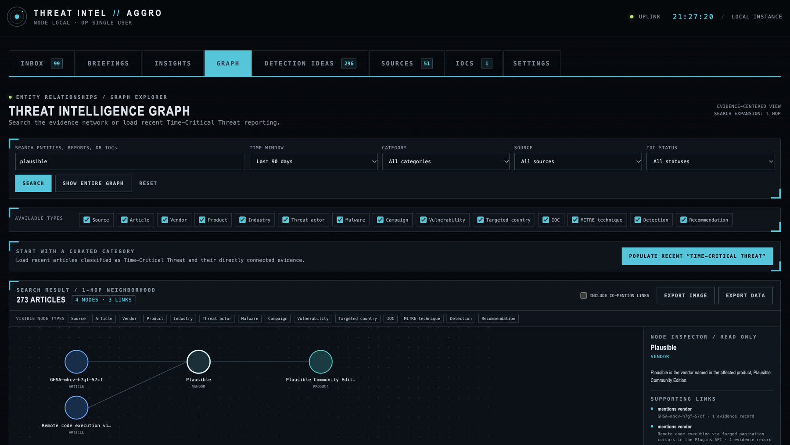

# Using Threat Intel Aggro

## Collect and review

Add RSS/Atom feeds or GitHub repositories under Sources, or import an OPML file. Submit an individual public URL or screenshot from the inbox. Review source excerpts, coverage limitations, and classification before using a finding.

Inbox filters include search, article state, category, and followed vendors, industries, and products. Settings controls the default coverage view. Graph and Insights summarize relationships in analyzed articles.





## Indicators

Malicious and suspicious indicators can be approved for export. Benign, unknown, and unlabeled observables remain available as context. Analyst classification retains the original role and can be reset. Classification and approval are separate actions.

Feed-level **IOC pre approved** approves findings after completed evidence-validated analysis, including eligible existing analyses when enabled. Turning it off retains earlier approvals. Older analyses without evidence validation require manual review.

Exclusions, dismissals, and expiry remove indicators from active exports. Configure lifetimes in Settings. Defaults are 90 days for IPs and URLs, 365 days for most other types, and 730 days for certificate thumbprints. A lifetime of 0 disables expiry. CSV protects formula-like values with an apostrophe.



## IOC API

Generate a key in Settings and copy it when displayed. Rotation keeps the previous key valid for 24 hours. Keys are stored as hashes.

```sh
curl -H "Authorization: Bearer $AGGRO_API_KEY" \
  "http://localhost:5088/api/iocs?days=14&classification=malicious"
```

`GET /api/iocs` returns `generatedUtc`, `query`, `count`, and `items`. Items include values, classification, approval, expiry, context, confidence, source articles, vendors, industries, and MITRE mappings.

| Parameter | Values |
| --- | --- |
| `days` or `n` | Lookback of 1–3650 days, default 7, based on publication or first-seen time |
| `vendor`, `industry`, `type`, `search` | Optional filters |
| `classification` | `malicious`, `suspicious`, or `context` |
| `includeUnapproved` | `true` explicitly includes actionable indicators awaiting approval |

Context-only indicators are excluded even when requested or approved. All `/api/*` routes require the bearer key. `/health` returns the database health status without a key.

## Briefings and RSS

Follow vendors, industries, and products in Settings. Briefings select matching analyzed articles from each 24-hour UTC window and preserve the matches in an archive. The schedule defaults to 06:00 UTC, waits for pending analysis, and backfills missed windows. Empty windows produce no briefing. Manual generation is available from Briefings.

Edit the generation prompt and schedule in Settings. Clearing the prompt restores its default. Archived briefings include executive summaries, article links, detection drafts, and defanged IOC overviews, with Markdown and PDF downloads.

Generate, rotate, or revoke RSS access in Settings. The secret URL grants access to up to 30 recent briefings, with article links and currently approved actionable IOCs. Copy it when displayed and keep it out of logs and traces. Invalid, rotated, and revoked IDs return 404. RSS responses use `Cache-Control: no-store`.



## Detection drafts

Review source evidence and KQL validation status, then download JSON, KQL, or XDRConverter YAML. Exported rules default to disabled. YAML requires a supported ATT&CK tactic. KQL and JSON remain available for older drafts missing one.

The bundled XDRConverter schema is pinned at commit `9c60aa8b653e89bf68ef4c318a92c1b62efe958b`. Evidence matching establishes provenance. Validate a draft in your environment before deploying it. See the [data contracts](DATA_CONTRACTS.md) for implementation details.



## Insights and graph

Use Insights to explore affected vendors, industries, threat actors, and reporting activity. Select an entity to focus on related entities.



Search the Graph for entities, reports, or indicators, then inspect their supporting links. Filters control the time window, category, source, and IOC status.


